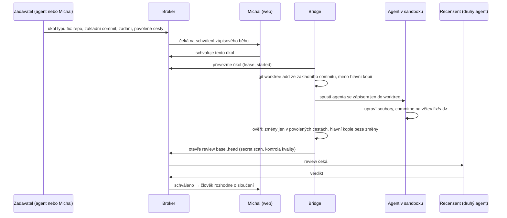

# Fáze C – návrh

**Datum:** 11. 11. 2026 · **Autor:** Ada (Fable 5.2, dočasný koordinátor) · **Stav:** návrh k oponentuře Noxe a ke schválení Michalem.
**Není to souhlas s implementací.** Michal 11. 11. povolil přejít do fáze C; fáze začíná tímto návrhem.

Fáze C podle [roadmapy](AGENT_LEASE_IMPROVEMENTS_ROADMAP.md): C1 úkol „oprava“ v izolovaném git worktree se zápisovým režimem bridge, C2 smyčka chyba → regresní test → oprava → testy → review → nejvýš 3 kola → člověk, C3 sledování spotřeby tokenů a stropy.

## 1. Co se fází C mění

Dnes bridge pouští agenty **jen pro čtení** (`codex exec --sandbox read-only`, `claude -p --permission-mode plan`). Výsledkem úkolu je text. Fáze C poprvé dovolí bezobslužnému agentovi **zapisovat do souborů**. To je největší změna bezpečnostního modelu od vzniku projektu, proto má návrh přísnější pravidla než zbytek systému.

Cíl: agent dostane úkol „oprav tohle“, opraví to ve vlastní izolované kopii repozitáře, výsledek projde testy a nezávislým review a člověk rozhodne o sloučení. Hlavní pracovní kopie se při tom nezmění ani o bajt.

## 2. Zásady

1. **Zápis jen do jednorázového worktree**, nikdy do hlavní kopie ani mimo repozitář.
2. **Izolaci vynucuje operační systém, ne prompt.** Kde ji neumíme vynutit, zápisový režim nepovolíme.
3. **Agent nikdy neslučuje a nenasazuje.** Výstupem je větev a otevřené review.
4. **Autor neschvaluje vlastní opravu.** Review dělá druhý agent, sloučení člověk.
5. **Přerušený zápisový běh se nikdy neopakuje naslepo** (platí už dnes: `needs_review`). Nový pokus začíná v čistém worktree.
6. **Žádný nový orchestrátor.** Staví se na existující frontě, nájmech, review (B3/B4), secret scanu (B6) a kontrole kvality (B7).
7. **Co nejméně nového kódu.** Každý krok má test, který selže, když záruka přestane platit.

## 3. C1 – úkol „oprava“ v izolovaném worktree

### 3.1 Průběh

### 3.2 Nový druh úkolu

Úkol typu `fix` nese navíc: absolutní cestu repozitáře, plný hash základního commitu a seznam povolených cest (výchozí: celé repo kromě cest, které B7 považuje za kritické – testy, CI, bezpečnost, samotná brána). Obyčejné úkoly zůstávají jen pro čtení beze změny.

### 3.3 Kdo smí zápisový běh povolit

| Vrstva | Kdo | Co povoluje |
|---|---|---|
| Operátorská politika (soubor mimo repozitář, jako `quality-runner.toml`) | Michal | Které repozitáře a kteří agenti smějí zápisový režim vůbec použít |
| Schválení úkolu ve webu | Michal | Tento jeden úkol, tento text, tento pokus (stejný mechanismus jako schválení karantény) |

V pilotu se schvaluje **každý** úkol. Automatické povolení nízkorizikových úkolů je možné až po vyhodnocení pilotu a novém Michalově rozhodnutí.

### 3.4 Izolace podle klienta

| Klient | Jak se vynutí „jen worktree“ | Návrh |
|---|---|---|
| Codex | Vestavěný sandbox: `codex exec --sandbox workspace-write -C <worktree>` (příkazy a zápis mimo pracovní adresář blokuje jeho sandbox) | **Pilot C1 jen s Codexem jako opravářem** |
| Claude Code | Nemá sandbox operačního systému; v zápisovém režimu smí Bash kamkoli, kam uživatel. Izolaci by musel dodat `bwrap` (worktree pro zápis, zbytek jen pro čtení), ale klient potřebuje síť a své přihlašovací údaje. | **Až ve druhém kroku**, po samostatném návrhu obalu a jeho oponentuře |

Ověřeno 11. 11. na nainstalovaných verzích (codex-cli 0.167.0, Claude Code 2.1.322): `codex exec` má `--sandbox`, `-C`, `--json`; `claude` má `--model`, `--allowed-tools`, `--max-budget-usd`. Chování sandboxu Codexu v režimu `workspace-write` (zejména síť a zápis do `.git` worktree) je nutné ověřit pokusem v prvním pracovním balíku; z nápovědy to neplyne.

Recenzentem oprav od Codexu je Ada (jen pro čtení, jak běží dnes).

### 3.5 Worktree

- Umístění: `~/.local/state/agent-lease/worktrees/<repo-id>/<task-id>-<pokus>/`, mimo hlavní kopii i mimo `~/.agent-lease`.
- Vzniká příkazem `git worktree add -b fix/<task-id>-<pokus> <cesta> <základní commit>` přes zpevněné volání gitu (`workspace._git_hardened`).
- Jeden pokus = jeden nový worktree. Rozpracovaný worktree se nikdy nepoužije znovu.
- Po uzavření review (sloučeno nebo zamítnuto) ho bridge odstraní; strop počtu a velikosti, starší se hlásí člověku, nemažou se samy.
- Nájmy: úkol si rezervuje své cesty ve worktree (B1). Hlavní kopie zůstává volná pro interaktivní práci.

### 3.6 Co bridge ověří po běhu, než cokoli ohlásí

1. Otisk hlavní pracovní kopie je stejný jako před během (`workspace.workspace_state`).
2. Všechny změněné soubory jsou uvnitř worktree a v povolených cestách; změna kritické cesty = `needs_review` s vysvětlením.
3. Výsledek je commit na větvi úkolu; necommitnuté zbytky = `needs_review`.
4. Proces a jeho potomci prokazatelně skončili (existující cgroup a run fence).
5. Teprve potom otevře review `base..head` se secret scanem.

Selže-li kterýkoli bod, úkol končí v `needs_review`, worktree zůstane pro kontrolu a nic se neohlásí jako hotové.

### 3.7 Co C1 výslovně nedělá

Neslučuje do žádné větve, nepushuje, nenasazuje, nemění konfiguraci, hooky ani služby, neinstaluje závislosti z internetu, nesahá na jiné repozitáře.

## 4. C2 – smyčka oprav

Stavy jedné opravy; každý přechod je deterministická kontrola, ne úsudek modelu:

| Krok | Co se stane | Kdo rozhoduje |
|---|---|---|
| 1. Reprodukce | Agent přidá regresní test. Brána ho pustí na základním commitu: **musí selhat**. | Kontrola kvality |
| 2. Oprava | Agent opraví kód ve stejném worktree, další commit. | — |
| 3. Testy | Brána pustí celou sadu na výsledném commitu: **musí projít**, včetně nového testu. | Kontrola kvality |
| 4. Review | Druhý agent posoudí `base..head`. | Recenzent |
| 5. Další kolo | „Požadované změny“ → nový pokus v novém worktree z poslední hlavy; nejvýš 3 kola (B4). | Počítadlo v review |
| 6. Eskalace | Po třetím kole, při neprůchodných testech nebo vyčerpaném rozpočtu → člověk. | Michal |

Krok 1 je jádro: oprava bez testu, který bez ní selže, se nepočítá. Změna testů je kritická cesta, takže ji podle B7 potvrzuje člověk; v C2 je to u nového regresního testu očekávané a schválení úkolu ve webu ho pokrývá jen pro soubory výslovně uvedené v zadání.

## 5. C3 – spotřeba a stropy

- **Kde číslo vzít:** `codex exec --json` a `claude -p --output-format json` hlásí spotřebu ve strukturovaném výstupu. Přesná pole se ověří na skutečném výstupu; kde klient spotřebu nehlásí, eviduje se „neznámo“, ne nula.
- **Co se ukládá:** u každého pokusu tokeny (vstup, výstup), délka běhu, model. Bez textu promptu.
- **Stropy:** na pokus, na úkol (součet kol) a na den pro agenta. Překročení zastaví **další** pokus před spuštěním a úkol jde člověku; běžící pokus se kvůli stropu nezabíjí uprostřed zápisu.
- **Model se připíná.** Bridge dnes pouští `claude -p` bez `--model`, takže běží na výchozím modelu účtu; změna výchozího modelu (11. 11. je to Fable 5.2) tiše změní cenu i chování bezobslužných běhů. Příkazy bridge mají model uvádět výslovně.
- **Přehled:** součty v existujícím dashboardu; žádný nový nástroj.

## 6. Co musí být hotové dřív

Fáze C stojí na věcech, které teď nejsou v pořádku. Bez nich se implementace nezačíná:

| Podmínka | Proč | Stav 11. 11. |
|---|---|---|
| Opravy z auditu sloučené a nasazené (review #11) | Nájem běžícího skriptu, uvolňování při konci tahu, eskalace review | Větev hotová a ověřená (795 testů), čeká na Noxe |
| Opravené P1 nálezy v B7 (F1 zastínění testů, F2 obejití schválení) | C2 se o výsledek brány opírá; dnes jde „PASS“ vyrobit bez testů | Zadáno Noxovi |
| Sandbox testů ve vlastní cgroup (F3) | Zápisové běhy a testy by jinak mohly shodit broker | Zadáno Noxovi |
| Rozhodnutí o hranici mezi agenty a „lidskými“ akcemi (nález auditu 6) | Schválení zápisového běhu chrání stejný token, který agenti umějí přečíst | Čeká na Michala |
| Kontrola `review check` před nasazením | Jinak se neschválená oprava může dostat do produkce | Zadáno Noxovi |
| Spuštěná relace Noxe | Bez ní nikdo nedává verdikty | Nox od 10. 11. nečte zprávy |

## 7. Rizika

| Riziko | Dopad | Opatření | Zbývá |
|---|---|---|---|
| Agent zapíše mimo worktree | Poškozená hlavní kopie nebo systém | Sandbox klienta, kontrola otisku hlavní kopie, pilot jen s Codexem | Chyba v sandboxu klienta |
| Agent upraví testy, aby prošly | Falešně zelená oprava | Kritické cesty mimo povolené, B7 lidské potvrzení, krok „test musí nejdřív selhat“ | Závisí na opravě F1 a F2 |
| Podvržené zadání (prompt injection v textu úkolu) | Zápisový běh udělá něco jiného | Karanténa textu, schválení každého úkolu člověkem, omezené cesty | Člověk schválí bez čtení |
| Smyčka pálí tokeny | Náklady | Stropy C3, nejvýš 3 kola, hodinový strop bridge | Klient spotřebu nehlásí |
| Hromadění worktree | Plný disk | Strop počtu a velikosti, úklid po uzavření review | — |
| Dva pokusy nad stejnými soubory | Konflikt | Rezervace cest úkolu (B1), jeden worktree na pokus | — |
| Schválení „za člověka“ agentem | Zápisový běh bez Michala | Viz podmínka o hranici v kapitole 6 | Do vyřešení drží jen pravidla |

## 8. Pracovní balíky

Žádný se nezačíná před Michalovým schválením tohoto návrhu a splněním kapitoly 6. Autor nikdy není recenzentem.

| Balík | Obsah | Autor | Recenzent | Hotovo, když |
|---|---|---|---|---|
| C0 | Pokus: chování `codex exec --sandbox workspace-write` ve worktree (zápis mimo adresář, síť, `.git`), tvar `--json` výstupu se spotřebou. Jen zpráva, žádný kód v produktu. | Nox | Ada | Zpráva s příkazy a výstupy; jasné ano/ne pro pilot |
| C1a | Úkol typu `fix`, operátorská politika, schválení ve webu | Ada | Nox | Úkol bez schválení se nespustí; test na každou cestu odmítnutí |
| C1b | Worktree: vytvoření, úklid, stropy | Nox | Ada | Hlavní kopie beze změny (test otiskem); přerušený běh nechá worktree a `needs_review` |
| C1c | Zápisový běh v bridge a kontroly po běhu (3.6), automatické otevření review | Nox | Ada | Zápis mimo povolené cesty končí `needs_review`; chaos test přerušení |
| C3a | Evidence spotřeby a připnutý model | Ada | Nox | Spotřeba u pokusu v DB; „neznámo“ místo nuly |
| C3b | Stropy | Ada | Nox | Strop zastaví další pokus (test) |
| C2a | Krok „test musí nejdřív selhat“ v bráně | Nox | Ada | Oprava bez selhávajícího testu neprojde |
| C2b | Smyčka kol a eskalace | Ada | Nox | Neopravitelná chyba eskaluje po 3 kolech (test) |
| C-pilot | Tři skutečné malé opravy v agent-lease pod dohledem | oba | Michal | Vyhodnocení: čas, tokeny, zásahy člověka |

Pořadí: C0 → C1a, C1b → C1c → C3a, C3b → C2a → C2b → pilot. C3 jde před C2, aby smyčka od začátku měla stropy.

## 9. Co potřebuje rozhodnout Michal

1. Souhlasí s pilotem **jen s Codexem jako opravářem** a Claude až po samostatném návrhu izolace?
2. Schvalovat v pilotu **každý** zápisový úkol ručně ve webu?
3. Kterým repozitářem začít? Návrh: jen agent-lease.
4. Stropy spotřeby na úkol a na den.
5. Jak vyřešit hranici mezi agenty a „lidskými“ akcemi (nález auditu 6): zákaz čtení tokenu a databáze v oprávněních agentů, nebo broker a web pod jiným uživatelem.

## 10. Co tento návrh neověřil

- Skutečné chování sandboxu Codexu ve worktree a tvar výstupu se spotřebou (balík C0).
- Zda jde Claude Code v zápisovém režimu spolehlivě uzavřít do `bwrap` se sítí a přihlašovacími údaji.
- Náklady: žádné měření, odhady se doplní po pilotu.
